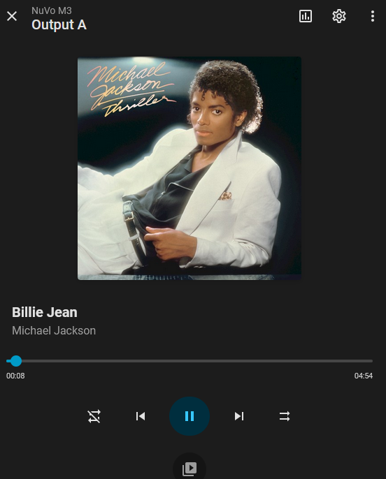

# NuVo NV-M3 Music Server for Home Assistant

[](https://hacs.xyz/docs/faq/custom_repositories/)
[](https://github.com/bru-living/ha-nuvo-m3/actions/workflows/validate.yml)
[](LICENSE)

[](https://my.home-assistant.io/redirect/hacs_repository/?owner=bru-living&repository=ha-nuvo-m3&category=integration)

A local, UI-configured Home Assistant integration for direct RS232 control of the **NuVo NV-M3 Music Server**. Bring your existing music collection into Home Assistant with three independent media players, a fast persistent library browser, album artwork, custom playlists, and TCP or local-serial connectivity.

NuVoNet and amplifier volume control are deliberately outside this integration's scope.

## Screenshot

### Media player with matched cover artwork



## Features

### New in 0.9.7: a fast, indexed music library

Scan once, then explore your collection from Home Assistant without waiting for the M3 to rebuild each live menu. The optional local catalogue remembers artists, albums, tracks and their native playback paths across Home Assistant restarts.

- Browse artists and albums, with album and track thumbnails when artwork fetching is enabled.
- Explore an alphabetical **Tracks** view, with large libraries split into pages of 100 tracks.
- Choose **Play all tracks** to start the M3's native whole-library playback, or **Play all album tracks** inside an album.
- Start a song from the indexed Tracks view and use Next or Previous across artist boundaries. Adjacent-track selection also handles M3 menus that start a single-track queue, and wraps at either end of the global track list.
- Watch the **Library index** sensor for scan phase, progress, collection counts, skipped items and the last successful scan.
- Keep the last complete catalogue if a scan fails or is cancelled. Slow menu pages are retried, inaccessible artist or album menus are reported and skipped, and damaged rows retain their original positions so later playback paths stay correct.
- Open **Live M3 menus** whenever you need the hardware's live view.

Press **Scan library** on the device page to scan using output A, or call `nuvo_m3.scan_library` and choose A, B or C. Use **Cancel library scan** or `nuvo_m3.cancel_library_scan` to cancel. The scan uses that output's menu session; playback continues, but wait for it to finish before browsing on the same output. Artwork enrichment runs when enabled, and ambiguous duplicate track titles keep their metadata unassigned.

If you already scanned with an earlier 0.9 version, run one new scan to add the global Tracks playback paths. Rescan after changing music on the M3 to refresh the local catalogue.

### Three independent outputs

The M3's physical outputs A, B and C are each represented by a media-player entity with:

- Play and pause.
- Next and previous track.
- Seeking, translated into the M3's relative skip-forward and skip-back commands.
- Shuffle and repeat.
- Current artist, album, title, track number, queue length, elapsed time and duration.
- Push updates from unsolicited M3 status packets.
- Position estimation between hardware updates.

The hardware protocol has no stop command, so the integration does not advertise unsupported stop functionality.

### Native music-library browsing

Open any output and select **Browse media** to navigate the M3's live menu system:

- Playlists
- Artists
- Albums
- Genres
- Tracks
- Play All
- Firmware-defined Options

The integration reconstructs the stateful M3 menu path for every request, preventing an expired or externally changed menu from playing the wrong item. Menus larger than the protocol's 20-item limit use fast Previous and Next pages.

After a successful browse, the native `MENUACTIVE` command keeps that output's menu alive every 10 seconds. The session is automatically released after 60 seconds of inactivity or immediately when playback begins.

### Home Assistant-managed playlists

The M3 protocol cannot create persistent server-side playlists. This integration therefore stores playlist definitions in Home Assistant while leaving all audio on the M3.

Available actions:

- `nuvo_m3.create_playlist`
- `nuvo_m3.delete_playlist`
- `nuvo_m3.add_current_track`
- `nuvo_m3.remove_playlist_track`
- `nuvo_m3.play_playlist`
- `nuvo_m3.stop_playlist`

Managed playlists appear under **Browse media > Home Assistant Playlists** and persist in Home Assistant's `.storage` directory.

### Optional cover artwork

Artwork enrichment is opt-in. When enabled, the integration sends the current artist, title and album to MusicBrainz, then obtains a matching image from the Cover Art Archive.

Matching favors:

- The exact recording artist rather than tribute performers.
- Official studio albums and soundtracks.
- Non-compilation, non-live and non-remix releases.
- English-language and UK, US, Irish, Canadian, Australian, New Zealand or worldwide editions.
- Earlier canonical releases over later collections.

Matches and misses are cached for the integration's lifetime. Lookup failures never interrupt local playback. The `artwork_status` media-player attribute reports `disabled`, `waiting_for_metadata`, `searching`, `found` or `not_found`.

### M3 Options controls

Shuffle and Repeat are exposed directly on each media player. Juke Box Mode is discovered dynamically through the firmware's Options menu and provided as a separate switch for outputs A, B and C.

The switches do not poll automatically because the M3 permits only one stateful menu session per output. Use `homeassistant.update_entity` to refresh a switch after changing Juke Box Mode from the front panel.

### Server and firmware diagnostics

The integration creates sensors for:

- Server status: `OFF`, `INITIALIZING`, `NORMAL` or `USBCONNECTED`.
- Main firmware version.
- Output A, B and C firmware versions.

Downloadable diagnostics include redacted connection configuration, packet and command counters, reconnect count, menu keepalive count, protocol errors, license-error counts, current output state and managed-playlist counts.

### Connections and reliability

- Raw serial-over-TCP bridges, defaulting to port 4999.
- Local serial devices such as `/dev/serial/by-id/...`.
- Fixed M3 serial settings: ISO-8859-1, 57,600 baud, 8 data bits, no parity, one stop bit and no flow control.
- Setup and reconfiguration connection testing.
- Serialized writes with 250 ms pacing for slower bridges.
- NUL-tolerant parsing for TCP serial adapters.
- Automatic reconnection with bounded exponential backoff.
- Periodic server-status heartbeat and connection-loss detection.
- Required server-status handshake during startup.

## Hardware notes

Use a straight-through RS232 cable, not a null-modem cable. The M3 DB9 uses pin 2 for TX, pin 3 for RX and pin 5 for ground.

USB is for Windows Media Player synchronization and firmware updates. It must be disconnected for normal playback; while connected, the server reports `USBCONNECTED`.

## Install

### HACS

1. In HACS, open **Integrations > Custom repositories**.
2. Add `https://github.com/bru-living/ha-nuvo-m3` and select **Integration**.
3. Install **NuVo NV-M3 Music Server**.
4. Restart Home Assistant.

### Manual installation

Copy `custom_components/nuvo_m3` into the `custom_components` directory in your Home Assistant configuration, then restart Home Assistant.

## Configure

Open **Settings > Devices & services > Add integration**, search for **NuVo NV-M3**, then choose:

- **TCP** for a transparent serial bridge. Enter its hostname/IP and raw TCP port.
- **Serial** for a local RS232 adapter. Prefer a stable `/dev/serial/by-id/...` path on Home Assistant OS.
- **Fetch cover artwork** if you accept sending playing metadata to MusicBrainz and the Cover Art Archive.

Use the integration's **Reconfigure** action to change the endpoint or artwork setting later. The replacement endpoint is tested before it is saved.

## Updating to 0.9.7

Update the existing installation in HACS and restart Home Assistant. The integration stores managed playlists and the library catalogue separately in Home Assistant's `.storage` directory. Back up your Home Assistant configuration before upgrading, and keep the existing integration entry so its stored collection remains associated with it.

After the restart, open **Browse media** on any output. Run **Scan library** to create the new index, or refresh an index created by an earlier 0.9 version. Your music files remain on the M3 throughout.

## Playlist example

1. Run `nuvo_m3.create_playlist` with a playlist name.
2. Browse and play a track on one M3 output.
3. Run `nuvo_m3.add_current_track` with that name and output.
4. Repeat for additional tracks.
5. Play it from **Browse media > Home Assistant Playlists** or call `nuvo_m3.play_playlist`.

Stopping a managed playlist stops automatic advancement. It cannot stop the current M3 track because the hardware has no stop command.

## Troubleshooting

- Confirm the TCP bridge is configured for transparent/raw serial data.
- Confirm another application, such as iTest, is not holding the serial connection.
- Disconnect USB before testing playback.
- Use a straight-through RS232 cable.
- Download diagnostics from the integration page; host and serial-path values are redacted.

Enable debug logging:

```yaml
logger:
  logs:
    custom_components.nuvo_m3: debug
```

Report problems through the [GitHub issue tracker](https://github.com/bru-living/ha-nuvo-m3/issues). Remove private addresses and track metadata from logs before posting them.

## Protocol and privacy

The local control implementation follows the *NV-M3 Serial Control Protocol*, revision 0.3, for M3 software 1.40. Commands are `*`-prefixed and carriage-return terminated; responses are `#`-prefixed.

RS232 control, browsing, playback and playlist storage remain local. Only optional artwork matching contacts public internet services.

## Development

Protocol parsing and command generation are isolated in `protocol.py`. Install `pytest`, `pytest-asyncio` and the manifest's serial dependency, then run `python -m pytest`. These tests cover the protocol layer independently of Home Assistant setup. GitHub Actions runs the protocol tests, Python compilation, JSON validation, HACS and Hassfest. The release workflow requires those checks to pass before publishing an archive and excludes generated Python bytecode.

Contributions are welcome; see [CONTRIBUTING.md](CONTRIBUTING.md). Security concerns should follow [SECURITY.md](SECURITY.md).

## License

MIT
